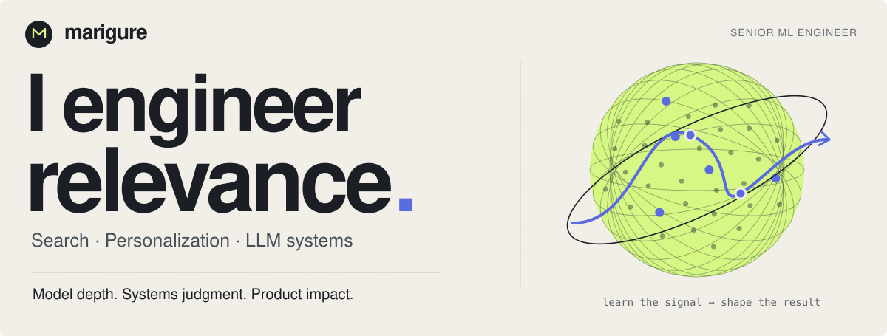
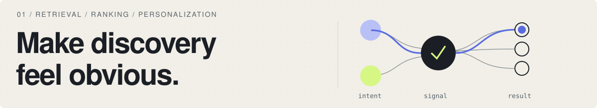
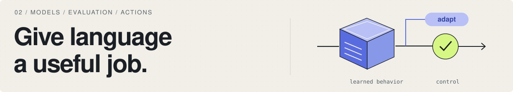
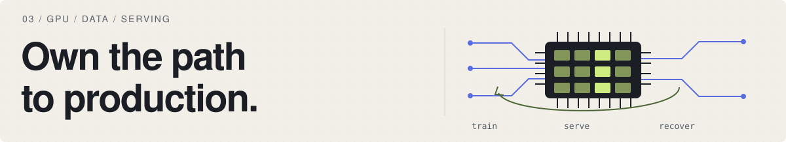

**Search is my depth. Models are my craft. Production is my responsibility.**

I'm **marigure**. I build **search, recommendation and LLM systems**, owning the path from training signals to the serving contract. My edge is **model depth with systems judgment**: I can improve what the model learns, explain why it helps, and engineer the release.

## Where I go deep

I connect **retrieval, ranking and personalization** into one product decision. I train representations, choose negatives, turn behavior into learning signals, and evaluate the experience after filters and product constraints.

`Contrastive learning` · `Neural retrieval` · `Transformer user models` · `LambdaMART`

I adapt language models to specific work: **extraction, grounded answers and controlled actions**. I use LoRA and independent evaluation to judge the model; authorization, confirmation and recovery are explicit parts of the execution design.

`LLM adaptation` · `RAG` · `Evaluation` · `Tool execution`

I build the data and runtime around the model: **CUDA / DDP training, versioned features, fast inference and compatible releases**. Memory, throughput, observability and failure modes belong in the design from the start.

`GPU training` · `Model serving` · `ML data` · `Release engineering`

## My standard

**Prove the gain. Budget the cost. Design for failure.**

I care about what users get, what it costs, and what happens when a dependency fails. The interesting work is choosing the objective, exposing the trade-off, and making the entire decision defensible.

<b>A few receipts</b>

- **Shared retrieval:** three product teams, a 160K+ item catalog, and **+2.3% relative qualified watch time** in user-level A/B testing of the shared release, with relevance and licensing guardrails.
- **Neural inference:** reranker **p99 690 → 390 ms**, at the same **40 RPS and traffic mix**, without increased failures.
- **LLM adaptation:** mandatory-constraint exact match **89% → 96%** on held-out dialogues, versus the prompt-only version of the same 7B model.
- **Controlled actions:** exact-argument confirmation, authorization, idempotency and status reconciliation. Timeout and restart tests found no duplicate operations in the tested scenarios.

## What I work with

  
  
  
  
  
  
  
  

**Modeling** · LoRA · DDP · LightGBM · CatBoost  
**Retrieval & inference** · OpenSearch · Qdrant · ONNX Runtime · vLLM  
**Data & delivery** · SQL · Kafka · Airflow · MLflow · AWS EKS

Based in **Vietnam/Almaty** · Remote work & **visa-supported relocation**.
